  

# Intraconnected

**Map your thinking as a tree of ideas.**

Intraconnected is a visual workspace for ideas, plans and projects. Every idea can hold more ideas, so a loose thought can grow into a structured plan without you ever having to start over in a new document.

**[Download for Windows](https://github.com/Africk-Hunter/intraconnected-releases/releases/latest)**  ·  [Open in your browser](https://intraconnected.app)

## Why Intraconnected

- **Focus on one idea at a time.** Click any idea to zoom into it, then step back out to see where it fits.
- **Reorganize as you think.** Drag an idea under another to move it. Every move and delete can be undone.
- **More than text.** Add links, checklists and notes, and mark what matters with High, Medium and Low priority.
- **See the whole picture.** The mind map view shows everything at once, with highlights for top priorities or your newest ideas.
- **Private where it counts.** Vault notes are locked with your own passphrase. We can't read vault notes.
- **Your data stays yours.** Export to Markdown, OPML or JSON at any time, on any plan.

## See it in action

**Zoom in to focus, step back out to see where it fits.**

**Drag to reorganize.** Drop an idea onto another to move it underneath, or onto the trash to delete it.

**Six kinds of ideas.** Parents, ideas, links, checklists, notes and vault notes, each with an optional priority.

## Get Intraconnected

| Platform | How |
| --- | --- |
| Web (desktop or phone browser) | [intraconnected.app](https://intraconnected.app) |
| Windows 10 and 11 | [Download the installer](https://github.com/Africk-Hunter/intraconnected-releases/releases/latest) |

Use the same account everywhere. Your ideas sync between devices.

## Installing on Windows

1. Open the [latest release](https://github.com/Africk-Hunter/intraconnected-releases/releases/latest) and, under **Assets**, download `Intraconnected Setup <version>.exe`. That is the only file you need. The others are used by the app's updater.
2. Run the installer.
3. Windows may show a "Windows protected your PC" message. Intraconnected is not yet code-signed, so Windows doesn't recognize it. Click **More info**, then **Run anyway**.
4. Sign in, or create an account.

## Updates

The desktop app gets new versions from this page. To check for an update, open **Profile > Data > Desktop App** in the app.

## Help

Questions, problems or ideas: [intraconnected.app/support](https://intraconnected.app/support)

---

This repository hosts Intraconnected's public releases. The source code is private.
